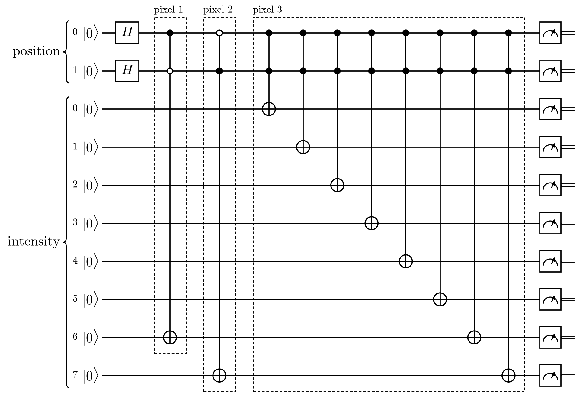

<a id="readme-top"></a>

<div align="center">

<h3 align="center">openqcv</h3>

  <p align="center">
    Quantum image representations: encode, export to OpenQASM, run, decode, draw.
  </p>
</div>

<details>
  <summary>Table of Contents</summary>
  <ol>
    <li>
      <a href="#about-the-project">About The Project</a>
      <ul>
        <li><a href="#goals">Goals</a></li>
        <li><a href="#built-with">Built With</a></li>
      </ul>
    </li>
    <li>
      <a href="#getting-started">Getting Started</a>
      <ul>
        <li><a href="#prerequisites">Prerequisites</a></li>
        <li><a href="#installation">Installation</a></li>
      </ul>
    </li>
    <li><a href="#usage">Usage</a></li>
    <li><a href="#roadmap">Roadmap</a></li>
    <li><a href="#contributing">Contributing</a></li>
    <li><a href="#license">License</a></li>
    <li><a href="#acknowledgments">Acknowledgments</a></li>
  </ol>
</details>

## About The Project



openqcv encodes images into quantum circuits (QPIE, FRQI, NEQR), exports them
as OpenQASM 2/3 with the metadata needed to decode, runs them on a backend and
decodes the result back into an image. Circuits are drawn as black-and-white,
textbook-style figures.

### Goals

1. Correct first: every representation round-trips exactly in the tests.
2. Nothing hidden: all data needed to decode is in the program, in the open.
3. Textbook circuits: standard gates only, drawn as they would be in a paper.
4. Backend independence: representations and backends share only OpenQASM.
5. Nothing speculative: features are added when specified, not in advance.

Design rules for contributors are in [AGENTS.md](AGENTS.md).

<p align="right">(<a href="#readme-top">back to top</a>)</p>

### Built With

* [![Python][Python-badge]][Python-url]
* [![Qiskit][Qiskit-badge]][Qiskit-url]
* [![NumPy][NumPy-badge]][NumPy-url]
* [![Matplotlib][Matplotlib-badge]][Matplotlib-url]

<p align="right">(<a href="#readme-top">back to top</a>)</p>

## Getting Started

### Prerequisites

* Python 3.10 or newer

### Installation

1. Clone the repo
   ```sh
   git clone https://github.com/Keno-00/open-quantum-computer-vision.git
   ```
2. Install it (editable)
   ```sh
   pip install -e open-quantum-computer-vision
   ```
3. Optional extras: `[image]` for `load_image` (Pillow), `[test]` for
   pytest, `[lint]` for ruff
   ```sh
   pip install -e "open-quantum-computer-vision[image,test,lint]"
   ```

<p align="right">(<a href="#readme-top">back to top</a>)</p>

## Usage

```python
import numpy as np
import openqcv as qcv

image = np.array([[0, 64], [128, 255]], dtype=np.uint8)

program = qcv.encode(image, "frqi")                     # "qpie", "frqi" or "neqr"
result = qcv.run(program, "simulator", shots=8192)      # or "statevector" (exact)
decoded = qcv.decode(result, program)

print(program.qasm())                                   # OpenQASM 3; program.qasm(2) for 2
qcv.draw(program).save("frqi.png")                      # circuit figure
qcv.compare(image, decoded).save("compare.png")         # original / decoded / difference
```

Programs serialise to JSON and decode without the encoding options:

```python
received = qcv.QasmProgram.from_json(program.to_json())
decoded = qcv.decode(qcv.run(received), received)
```

| Representation | Qubits for *N* pixels | Circuit |
|---|---|---|
| `qpie` | ⌈log₂N⌉ | Grover–Rudolph R<sub>y</sub> tree |
| `frqi` | ⌈log₂N⌉ + 1 | one controlled R<sub>y</sub>(2θ<sub>i</sub>) per pixel |
| `neqr` | ⌈log₂N⌉ + bit depth | one controlled NOT per set intensity bit |

Conventions: bitstrings are in qubit order (character `j` is qubit `j`);
the first qubit of a register is its least significant bit; pixels are
row-major.

<p align="right">(<a href="#readme-top">back to top</a>)</p>

## Roadmap

- [x] QPIE, FRQI, NEQR
- [x] OpenQASM 2/3 export and textbook logical QASM
- [x] Exact and sampled local backends
- [x] Circuit and image figures
- [ ] Hardware backends
- [ ] More representations

<p align="right">(<a href="#readme-top">back to top</a>)</p>

## Contributing

Read [AGENTS.md](AGENTS.md) first. Then:

1. Fork the Project
2. Create your Feature Branch (`git checkout -b feature/AmazingFeature`)
3. Check it (`ruff format --check .`, `ruff check .`, `pytest`)
4. Commit your Changes (`git commit -m 'Add some AmazingFeature'`)
5. Push to the Branch (`git push origin feature/AmazingFeature`)
6. Open a Pull Request

<p align="right">(<a href="#readme-top">back to top</a>)</p>

## License

No license has been chosen yet.

<p align="right">(<a href="#readme-top">back to top</a>)</p>

## Acknowledgments

* Yao et al., *Quantum image processing and its application to edge detection* (QPIE), Phys. Rev. X 7, 031041 (2017)
* Le, Dong & Hirota, *A flexible representation of quantum images* (FRQI), Quantum Inf. Process. 10, 63 (2011)
* Zhang et al., *NEQR: a novel enhanced quantum representation of digital images*, Quantum Inf. Process. 12, 2833 (2013)
* Grover & Rudolph, *Creating superpositions that correspond to efficiently integrable probability distributions*, arXiv:quant-ph/0208112
* [Best-README-Template](https://github.com/othneildrew/Best-README-Template)

<p align="right">(<a href="#readme-top">back to top</a>)</p>

<!-- MARKDOWN LINKS & IMAGES -->
[Python-badge]: https://img.shields.io/badge/Python-3776AB?style=for-the-badge&logo=python&logoColor=white
[Python-url]: https://www.python.org/
[Qiskit-badge]: https://img.shields.io/badge/Qiskit-6929C4?style=for-the-badge&logo=qiskit&logoColor=white
[Qiskit-url]: https://www.ibm.com/quantum/qiskit
[NumPy-badge]: https://img.shields.io/badge/NumPy-013243?style=for-the-badge&logo=numpy&logoColor=white
[NumPy-url]: https://numpy.org/
[Matplotlib-badge]: https://img.shields.io/badge/Matplotlib-11557C?style=for-the-badge&logoColor=white
[Matplotlib-url]: https://matplotlib.org/
