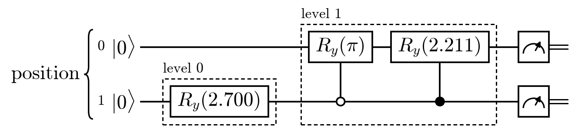
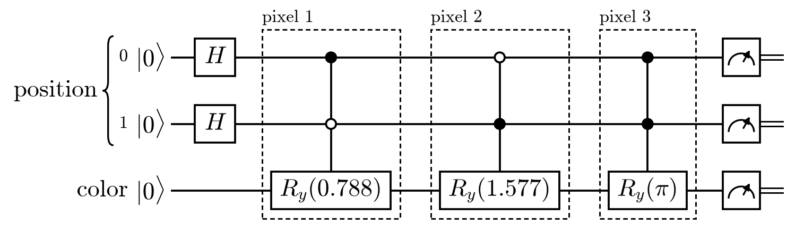
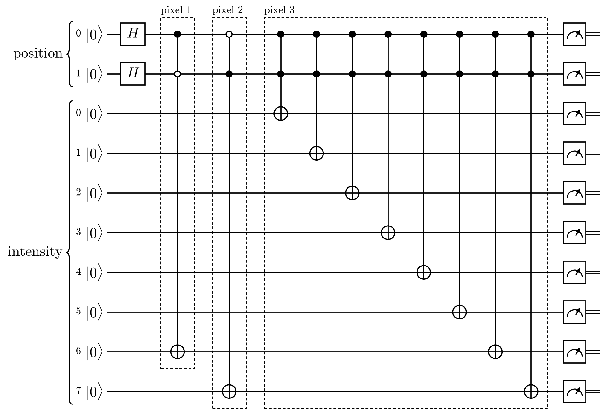

Representations
===============

The figures show the logical circuit of each representation for the
:math:`2 \times 2` image with intensities 0, 64, 128 and 255.

.. currentmodule:: openqcv.representations

QPIE
----

.. autoclass:: QPIE
   :members:

FRQI
----

.. autoclass:: FRQI
   :members:

NEQR
----

.. autoclass:: NEQR
   :members:

Base class and helpers
----------------------

.. automodule:: openqcv.representations.base
   :members:
