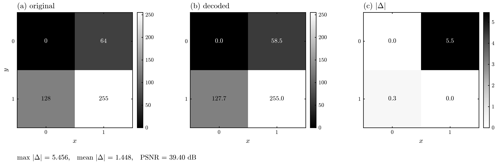

Visualization
=============

Circuits
--------

.. automodule:: openqcv.viz.circuit
   :members: draw

Images
------

.. automodule:: openqcv.viz.image
   :members:

   :func:`compare` for the FRQI image above, decoded from 2000 shots.

Style
-----

.. automodule:: openqcv.viz.drawing
   :members:
